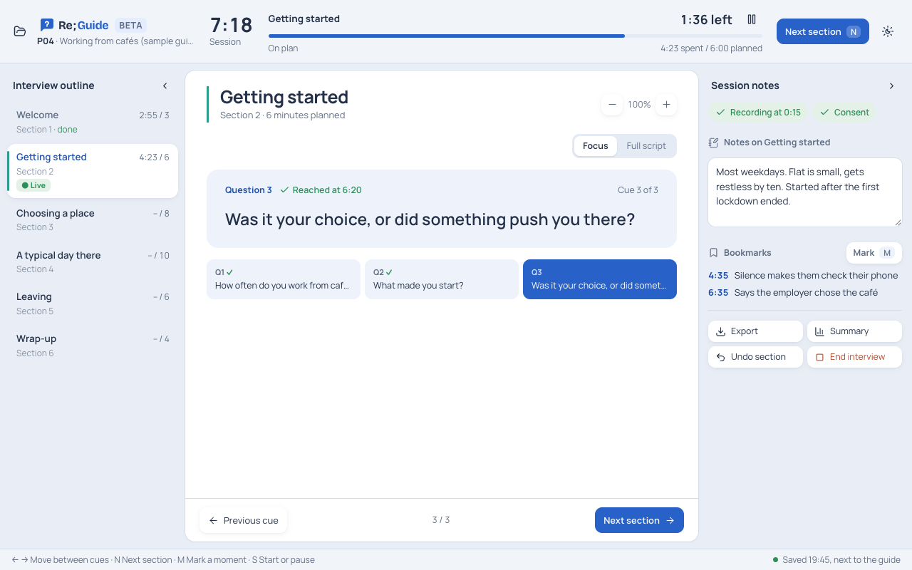
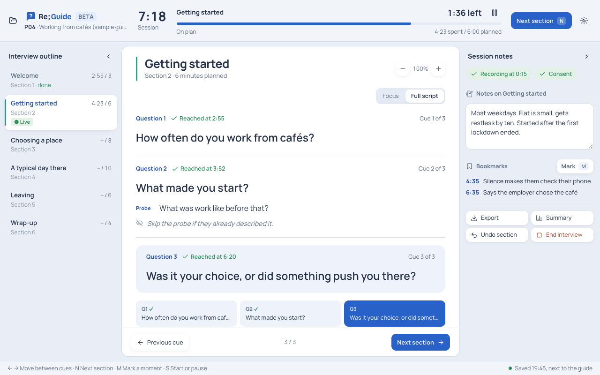
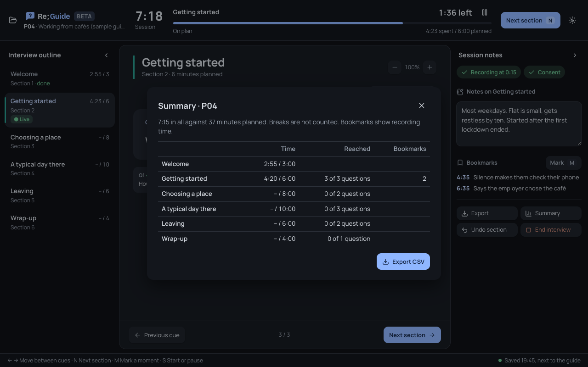

# Re;Guide

A free app for running interviews from your guide, for Mac and Windows. Beta.



We built it for our own convenience during a study.

- Write your guide as a plain text file.
- See one question at a time, or the whole script.
- A clock for each section shows if you're running over.
- Take notes, and press M to bookmark a moment in the recording.
- Pause for breaks. Undo if you skip ahead by mistake.
- It saves as you go. If the app closes, you pick up where you left off.
- Export times, notes and bookmarks to CSV.

No account. Your files stay on your computer.




## Download

Get it from [Releases](../../releases). On a Mac, pick `aarch64.dmg` for M1 and later, or `x64.dmg` for older Intel Macs. On Windows, pick the `.msi` or `.exe`.

The app isn't signed yet, so you'll get a warning the first time. On a Mac, go to System Settings → Privacy & Security and click **Open Anyway**. On Windows, click **More info**, then **Run anyway**.

Click **Try the sample** to look around first.

## Writing a guide

```
# My study
## Warm-up (5 min)
Say: Thanks for joining.
Ask: How did you start freelancing?
Probe: What made you choose it?
Note: Skip if they already said it.
```

More in [docs/guide-format.md](docs/guide-format.md).

## Build it yourself

You need Node.js, Python 3 and [Rust](https://rustup.rs).

```
npm install
npm run build
```

## Coming later

Guides in two languages.

See also [Re;Code](https://github.com/azmainmahdi/re-code), for analysing the interviews.

MIT licence. Fonts and icons are listed in [THIRD-PARTY.md](THIRD-PARTY.md).
